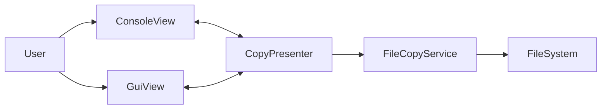

## 总体目标

- **实现一个可在 Windows 上运行的 Python 应用**，支持：
  - 递归复制目录中文件
  - 基于黑名单/白名单规则的文件过滤
  - 覆盖策略：`always` / `skip`
  - 采用 **MVP 设计模式**，支持 **控制台 View** 与 **Tkinter GUI View** 共用同一业务逻辑。

## 架构设计

- **核心思想**：
  - 将“复制配置 + 过滤规则 + 复制执行逻辑”放在 Model/Service 层。
  - Presenter 持有 View 和 Service，负责调度流程和错误处理。
  - View 仅负责输入输出（控制台文本或 GUI 控件）。
- **主要模块与文件（建议）**：
  - `[main.py](main.py)`：程序入口，解析命令行参数，选择控制台或 GUI 模式，创建 Presenter 并运行。
  - `[models.py](models.py)`：定义复制相关的配置与统计数据模型。
  - `[services.py](services.py)`：提供文件系统遍历、过滤应用、文件复制的核心逻辑。
  - `[presenter.py](presenter.py)`：定义 `CopyPresenter`，协调 View 和 Service。
  - `views` 目录：
    - `[views/base_view.py](views/base_view.py)`：定义 View 接口/抽象基类 `ICopyView`。
    - `[views/console_view.py](views/console_view.py)`：实现控制台版 View。
    - `[views/gui_view.py](views/gui_view.py)`：实现 Tkinter 窗口版 View。
- **简要架构图（MVP 交互）**：

## Model 与 Service 设计

- `**CopyRule` / 过滤规则**（在 `models.py`）：
  - 属性：
    - `include_patterns: list[str]` 白名单 glob 模式，可为空
    - `exclude_patterns: list[str]` 黑名单 glob 模式，可为空
  - 行为：
    - `match(path_relative, filename)`：根据预设策略判断文件是否“允许复制”。
- **过滤策略（已与用户确认）**：
  - 使用 **glob 通配符**（`fnmatch` 或 `pathlib`）：
    - 例：`"*.py"`, `"logs/**"`, `"data/**/*.csv"`。
  - 匹配对象：
    - 文件名：如 `file.txt`
    - 相对路径：如 `subdir/file.txt`
  - 判定流程：
    - 若 `include_patterns` 非空：文件必须命中其中至少一个模式才“有资格被复制”。
    - 然后应用 `exclude_patterns`：命中任一黑名单模式则最终 **不复制**。
    - 即：**黑名单优先级高于白名单**。
  - 若白名单和黑名单都为空：默认复制所有文件。
- `**CopyConfig`**（在 `models.py`）：
  - 属性：
    - `src_dir: str`
    - `dst_dir: str`
    - `rules: CopyRule`
    - `overwrite_mode: Literal["always", "skip"]`
- `**CopyStats`**（在 `models.py`）：
  - 属性示例：
    - `total_files`, `copied_files`, `skipped_files`, `total_bytes`, `copied_bytes`
- `**FileCopyService`**（在 `services.py`）：
  - 主要方法：
    - `run_copy(config: CopyConfig, progress_cb: Callable)`：执行递归复制。
  - 实现要点：
    - 使用 `os.walk` / `pathlib` 递归遍历 `src_dir`。
    - 为每个文件构造相对路径，交给 `CopyRule` 判断是否复制。
    - 目标路径：`dst_dir` + 相对路径，保证层级结构一致。
    - 按 `overwrite_mode`：
      - `always`：直接覆盖（必要时先创建父目录）。
      - `skip`：若目标存在文件，则计入 `skipped_files` 并跳过。
    - 每处理一个文件（或每 N 个文件）调用 `progress_cb(info)` 向 Presenter 报告进度（文件路径、是否复制、累计统计等）。

## View 接口与 Presenter 设计

- `**ICopyView` 接口（`views/base_view.py`）**：
  - 关键方法：
    - `get_initial_config(cli_args) -> CopyConfig | None`：
      - 控制台：结合命令行参数和交互式输入构造配置；若用户取消则返回 `None`。
      - GUI：从界面控件读取配置。
    - `on_progress(info)`：接收 Presenter 提供的进度信息并展示（文本/进度条）。
    - `show_summary(stats: CopyStats)`：展示最终结果。
    - `show_error(message: str)`：显示错误信息。
- `**CopyPresenter`（`presenter.py`）**：
  - 依赖注入：
    - `view: ICopyView`
    - `service: FileCopyService`
  - 核心方法：
    - `run(cli_args)`：
      1. 调用 `view.get_initial_config(cli_args)` 获取完整 `CopyConfig`。
      2. 若返回 `None`，视为用户取消，结束流程。
      3. 调用 `service.run_copy(config, progress_cb=self._on_service_progress)`。
      4. 捕获异常，调用 `view.show_error(...)`。
      5. 完成后调用 `view.show_summary(stats)`。
    - `_on_service_progress(info)`：
      - 更新内部统计对象 `CopyStats`。
      - 调用 `view.on_progress(info)` 实时刷新界面。

## 控制台 View 设计

- **命令行参数设计**（在 `main.py` 使用 `argparse`）：
  - `--mode {console,gui}`：选择运行模式（默认 `gui` 或 `console`，可在实现时定）。
  - `--src PATH`：源目录。
  - `--dst PATH`：目标目录。
  - `--include PATTERNS`：白名单模式字符串，使用分号 `;` 分隔多个模式。
  - `--exclude PATTERNS`：黑名单模式字符串，使用分号 `;` 分隔多个模式。
  - `--overwrite {always,skip}`：覆盖策略。
- `**ConsoleView` 行为（`views/console_view.py`）**：
  - 在 `get_initial_config(cli_args)` 中：
    - 若命令行已提供必要参数：直接解析为 `CopyConfig`。
    - 若缺少参数：在控制台以交互方式询问：
      - 源目录 / 目标目录（并校验是否存在/可创建）。
      - include / exclude 模式（可允许为空，使用 `;` 或逗号分隔）。
      - overwrite 模式（给出简短提示：`1=always, 2=skip`）。
  - `on_progress(info)`：
    - 打印当前处理文件（可简略显示相对路径）。
    - 适度显示复制/跳过统计（例如每 N 个文件输出一次）。
  - `show_summary(stats)`：
    - 输出总文件数、复制数、跳过数、总大小等。

## GUI View 设计（Tkinter）

- **窗口布局（`views/gui_view.py`）**：
  - 主要元素：
    - 源目录选择：文本框 + “浏览...” 按钮（`tkinter.filedialog.askdirectory`）。
    - 目标目录选择：同上。
    - include / exclude 输入框：多行文本（每行一个或使用分号分隔）。
    - 覆盖策略选择：下拉框（`always` / `skip`）。
    - “开始复制”按钮。
    - 进度显示：
      - 进度条（可简单用 `ttk.Progressbar`，按文件数估算进度）。
      - 滚动文本区域用于显示当前正在复制的文件、错误信息等。
- **GUI 与 Presenter 交互**：
  - `get_initial_config(cli_args)`：
    - 在用户点击“开始复制”按钮后收集界面信息并返回 `CopyConfig`。
  - `on_progress(info)`：在 Tkinter 主线程中通过 `after()` 安全更新控件文本和进度条。
  - `show_summary(stats)`：在文本/弹窗中显示最终统计。
  - 考虑长时间操作时防止界面假死：
    - 复制逻辑可在后台线程执行，Presenter 通过线程安全队列或 Tkinter `after()` 推送进度到 UI。

## `main.py` 入口流程

- 使用 `argparse` 解析参数，决定：
  - 运行模式：
    - 若 `--mode gui` 或无参数：启动 GUI 模式，创建 `GuiView`，构造 Presenter 并进入 Tkinter 主循环。
    - 若 `--mode console`：启动控制台模式，创建 `ConsoleView`，构造 Presenter 并调用 `run(cli_args)`。
- 为未来扩展保留空间（如添加日志文件输出等）。

## 后续可选增强（本次实现中不强制）

- 增加“只复制更新过的文件”（按修改时间比较）。
- 记录失败文件列表并导出为日志。
- 增加简单的单元测试，覆盖过滤规则与复制逻辑。

